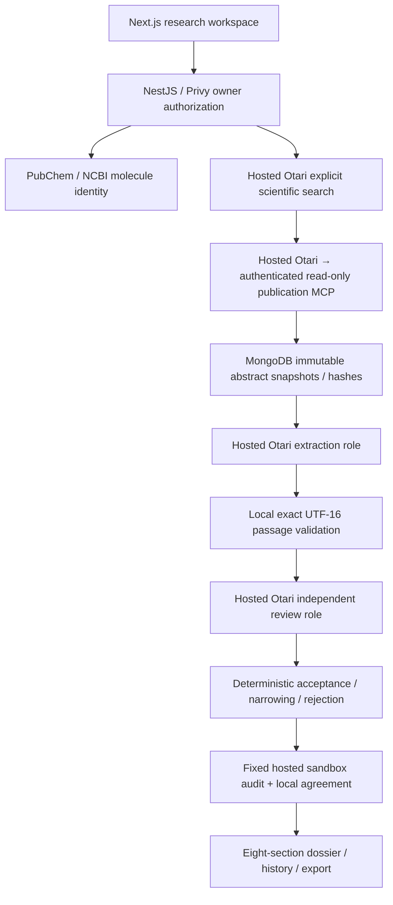

# Capela

An evidence-first molecule investigation workspace: inspect source passages, model-assisted review, deterministic corrections and uncertainty before accepting a claim.

Built for [Mozilla Developers Wilding Online](https://otari.ai/devs-wilding). The [official judging rubric](https://docs.google.com/document/d/1-spnCZ3f2SSki8cb6FnochjchdyttUsjjxfoE6aBnF4/edit) defines the competition; no awarded score or submission status is claimed.

## Current architecture



The verified isolated model pair resolved to **`openai/gpt-oss-20b` for structured extraction** and **`openai/gpt-oss-120b` for adversarial evidence review**, through hosted Otari. Configuration aliases alone do not establish model identity: run events retain observed resolved model headers. Both model repositories identify Apache 2.0 ([20b](https://huggingface.co/openai/gpt-oss-20b/blob/main/LICENSE), [120b](https://huggingface.co/openai/gpt-oss-120b/blob/main/LICENSE)). Different purposes matter; fallback alone is not a second role.

Extraction reads one stored abstract per bounded call. Extraction and review select stable passage IDs from a persisted snapshot index; the backend constructs exact quotes and UTF-16 offsets from stored data. Unknown, stale and cross-source references are rejected without fuzzy matching. Review reads at most two claims per bounded call and saves completed batches. Every publishable claim must retain valid source identity/hash and exact passages, pass conservative review/classification, and pass a fixed remote audit that agrees with local validation. Model agreement is not proof of scientific truth. Animal/cell, computational and reported findings remain explicitly scoped; abstracts are never labeled full text. Evidence scores are heuristics, not efficacy probabilities.

MongoDB leases, heartbeat/fencing and durable reservations protect run ownership. Interrupted calls may have been charged and are never automatically replayed. New validated search checkpoints allow an explicit retry after MCP failure without buying the same search again; older runs without that checkpoint cannot recover invented URLs. Terminal denials stop new spending. Optional direct Vertex review is labeled **hybrid**, billed separately, and excluded from the qualifying demonstration. Original direct Gemini/Groq/Tavily implementation details live in [the archived legacy document](docs/LEGACY_ARCHITECTURE.md).

## Verification status — November 10, 2026

**Six selected Otari capability categories have execution evidence:** search, authenticated MCP, code execution, distinct model roles, hosted spending limits and inference guardrails. Evidence spans a completed local application investigation and separate isolated production-adapter checks; it is not one run exercising all six. Judges determine credit; no awarded score is claimed.

| Capability           | Actual execution                                                                                                                                                   | Scope and limitation                                                                                                                                                                            |
| -------------------- | ------------------------------------------------------------------------------------------------------------------------------------------------------------------ | ----------------------------------------------------------------------------------------------------------------------------------------------------------------------------------------------- |
| Search               | Hosted search selected the investigation's canonical source.                                                                                                       | Completed authenticated November 6 investigation.                                                                                                                                               |
| MCP                  | Hosted authenticated publication tool retrieved the stored abstract used by both models.                                                                           | Same completed investigation.                                                                                                                                                                   |
| Distinct model roles | Observed `openai/gpt-oss-20b` extraction and `openai/gpt-oss-120b` review.                                                                                         | Same completed investigation; Vertex excluded.                                                                                                                                                  |
| Code execution       | Nonempty hosted audit matched local validation for the original two records.                                                                                       | Revised one-finding publication state was audited locally, not relabeled as another hosted audit.                                                                                               |
| Spending limits      | Actual isolated $0.01 workspace ceiling returned `budget_exceeded`; Capela blocked another dispatch.                                                               | Separate isolated adapter check; original runtime key's finite ceiling remains unknown.                                                                                                         |
| Inference guardrails | Request `1c30c704-3335-4ee9-a68c-dbd60a4dfb57` returned 403, `guardrail_violation` and an evaluated blocking result for the expected profile in the same response. | Separate isolated synthetic-injection check through the production adapter. No manual vendor-log association needed for this new result; no benign pass-rate or detector-specific causal claim. |

Normal routing policies also executed with distinct resolved models, but both reported `fallback:false`. Successful backup recovery and per-user budgets remain unverified and are not needed to describe the six selected categories above.

**The curcumin investigation completed and reopened; its downloaded export was inspected.** One canonical review abstract supplied two original model-accepted literature-reported findings. Later source inspection found unsupported added wording in claim 2. A separately recorded publication revision now publishes **one finding and retains the second as unresolved**, preserving the original supported model verdicts, events and costs. The current gate automatically reapplies the recorded source assessment only to exact source/finding/span recurrences. It is not automatic reviewer detection or a general entailment classifier.

The [read-only HTML/JSON sample](apps/web/public/samples/curcumin-2026-11-06.html) preserves that provenance, contains no account identifiers or mutation controls, and opens at `/samples/curcumin-2026-11-06.html` in the running application. This repository artifact is not a verified deployed preview. Findings remain literature reported from **one review abstract**, not direct experiments or demonstrated human outcomes.

Fixed-source mechanical checks passed **10/10 hashes, 30/30 references and 30/30 exact passages**. Recorded authenticated application checks are separate from offline fixtures. Mechanical integrity, model agreement and security guardrails do not establish scientific accuracy or prove reviewer improvement. Coverage remains abstract-only and review is model-assisted.

Current release results are in [TEST_EVIDENCE](docs/TEST_EVIDENCE.md); exact model/tool/request IDs and tested-source hashes are in [RUBRIC_EVIDENCE](docs/RUBRIC_EVIDENCE.md). New direct guardrail evidence: [metadata verification](evaluation/hosted-guardrail-metadata-verification.json) and [pinned contract](evaluation/guardrail-metadata-contract.json). The [original inconclusive request](evaluation/hosted-guardrail-verification.json) and [owner-supplied Lakera observation](evaluation/hosted-guardrail-owner-observation.json) remain unchanged historical evidence. No whole-investigation replay was made for this metadata check.

## Run locally

Use Node 24, npm, MongoDB and the existing Privy application. Copy `.env.example` to ignored `.env.local` and configure credentials locally. Never place runtime secrets in `NEXT_PUBLIC_*` variables. Keep payments in their existing state.

```bash
nvm use
npm install
npm run dev
```

The default API is `http://localhost:4000`, web `http://localhost:3000`. Configure `NEXT_PUBLIC_API_URL` and `WEB_ORIGIN` consistently when changing ports. [Hosted setup](docs/OTARI_INTEGRATION.md) covers role policies, the authenticated remote MCP server and finite hosted ceiling. A positive application cap does not prove hosted enforcement. No paid check is authorized merely by changing an environment value; reconcile persistent task/application ledgers first. `OTARI_RUN_MAX_CALLS` optionally reduces per-run dispatches (for example five for a one-abstract verification); retries retain the original limit.

`npm run smoke:otari` reads catalogs without paid execution. Paid scripts refuse conflicting/existing task ledgers. The default application never silently switches to Gemini/Groq if Otari is unavailable. Production Privy authentication remains required for private investigations, sources, history, retries and exports.

## Verification commands

Run generated-file gates sequentially:

```bash
npm test
npm run test:integration
npm run test:browser
npm run evaluate
npm run format:check
npm run lint
npm run typecheck
npm run build
```

Unit/integration/browser fixtures spend no paid credits. `npm run evaluate` checks source hashes, reference integrity and exact passages in fixed records and writes versioned results to `evaluation/results.json`.

## API and participant handoff

Nest Swagger is at `/docs`, its OpenAPI JSON at `/docs/openapi.json`. Shared Zod contracts live in `packages/shared`; research services in `apps/api/src/research`; the responsive dossier and inspection UI in `apps/web/src`.

See the [participant recording checklist](docs/DEMO_RECORDING_CHECKLIST.md), [submission checklist](docs/SUBMISSION_CHECKLIST.md), [current rules](docs/MOZILLA_RULES.md) and [implementation plan](docs/IMPLEMENTATION_PLAN.md). The participant records actual application screens with their own audio; no generated demo video or narration is supplied. The verified submission route is the event's email thread, not an invented DoraHacks link. The hackathon branch has been published with owner authorization. The current metadata follow-up has not been pushed or deployed; no submission email or recording was generated.
