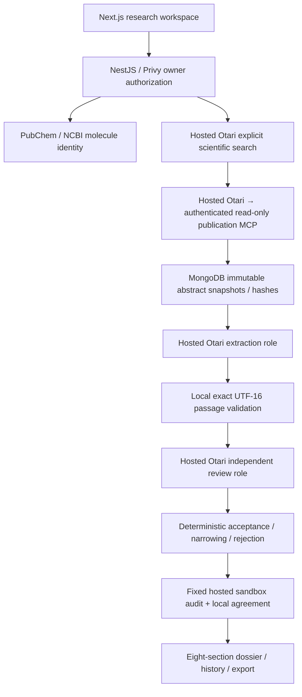

# Capela

An evidence-first molecule investigation workspace: inspect source passages, model-assisted review, deterministic corrections and uncertainty before accepting a claim.

Built for [Mozilla Developers Wilding Online](https://otari.ai/devs-wilding). The [official judging rubric](https://docs.google.com/document/d/1-spnCZ3f2SSki8cb6FnochjchdyttUsjjxfoE6aBnF4/edit) defines the competition; no awarded score or submission status is claimed.

## Current architecture



The verified isolated model pair resolved to **`openai/gpt-oss-20b` for structured extraction** and **`openai/gpt-oss-120b` for adversarial evidence review**, through hosted Otari. Configuration aliases alone do not establish model identity: run events retain observed resolved model headers. Both model repositories identify Apache 2.0 ([20b](https://huggingface.co/openai/gpt-oss-20b/blob/main/LICENSE), [120b](https://huggingface.co/openai/gpt-oss-120b/blob/main/LICENSE)). Different purposes matter; fallback alone is not a second role.

Extraction reads one stored abstract per bounded call. Extraction and review select stable passage IDs from a persisted snapshot index; the backend constructs exact quotes and UTF-16 offsets from stored data. Unknown, stale and cross-source references are rejected without fuzzy matching. Review reads at most two claims per bounded call and saves completed batches. Every publishable claim must retain valid source identity/hash and exact passages, pass conservative review/classification, and pass a fixed remote audit that agrees with local validation. Model agreement is not proof of scientific truth. Animal/cell, computational and reported findings remain explicitly scoped; abstracts are never labeled full text. Evidence scores are heuristics, not efficacy probabilities.

MongoDB leases, heartbeat/fencing and durable reservations protect run ownership. Interrupted calls may have been charged and are never automatically replayed. New validated search checkpoints allow an explicit retry after MCP failure without buying the same search again; older runs without that checkpoint cannot recover invented URLs. Terminal denials stop new spending. Optional direct Vertex review is labeled **hybrid**, billed separately, and excluded from the qualifying demonstration. Original direct Gemini/Groq/Tavily implementation details live in [the archived legacy document](docs/LEGACY_ARCHITECTURE.md).

## Verification status — November 6, 2026

**A nonempty hosted-only investigation completed on November 6.** The actual signed-in Node 24 application resolved curcumin, executed hosted search, retrieved one canonical review abstract through authenticated MCP, extracted and independently reviewed two findings using distinct observed open-weight models, and published after a nonempty hosted sandbox audit agreed locally. Both roles selected passage IDs; all 2/2 candidate and 2/2 reviewer references hydrated to valid exact spans. The saved dossier reopened and its downloaded PNG was inspected.

The original models accepted two literature-reported candidates. A separately recorded **post-run publication revision now publishes one finding and withholds claim 2 as unresolved**: its added NF-κB background clause is not supported by the selected passage. The original reviewer returned `supported` with all checks true; those outputs, events, costs and the original run remain unchanged. An evidence-bound assistant source-inspection hold now affects the publication policy, rather than remaining a note. This is not a new model correction or a general entailment detector. The [read-only sample](apps/web/public/samples/curcumin-2026-11-06.html) shows both original model verdicts and the later publication decisions. Current one-finding evidence was audited locally; the original two-record hosted audit is preserved separately. Findings remain **literature reported**, not direct experiments or demonstrated human outcomes. Open `/samples/curcumin-2026-11-06.html` in the running local app; this artifact has not been deployed or published externally. It contains no account identifiers or mutation controls.

**The six-capability target is not demonstrated.** Four categories now have evidence within this complete application run: search, MCP, sandbox and distinct model roles. Routing selection has actual policy calls. A separate isolated workspace now has a real hosted $0.01 ceiling refusal through the production adapter, with terminal no-bypass behavior; this is separate from the completed investigation. Successful role-preserving fallback recovery and the original runtime key’s hosted ceiling remain unverified. Controlled fault/denial tests are optional evidence methods. Passage validity and model agreement do not establish scientific truth or show that review improves correctness.

| Capability           | Code                                                                                                                                       | Actual evidence / current limit                                                    | Demonstration step                                                |
| -------------------- | ------------------------------------------------------------------------------------------------------------------------------------------ | ---------------------------------------------------------------------------------- | ----------------------------------------------------------------- |
| Search               | [explicit tool](apps/api/src/research/otari-search.ts)                                                                                     | Executed in the completed November 6 application run                               | Show search event and canonical source selection                  |
| MCP                  | [retrieval](apps/api/src/research/otari-retrieval.service.ts), [authenticated server](apps/api/src/research/publication-mcp.controller.ts) | Application hosted invocation; canonical abstract saved and used                   | Show tool invocation and its stored abstract                      |
| Distinct model roles | [extraction/review](apps/api/src/research/otari-evidence.service.ts)                                                                       | Actual 20b extraction / 120b review in the completed run                           | Show both observed models and a real review decision              |
| Sandbox              | [fixed audit](apps/api/src/research/evidence-audit.ts)                                                                                     | Nonempty hosted audit: two literature-reported records, local agreement            | Show audit hash, accepted count and local agreement               |
| Routing / fallback   | [gateway](apps/api/src/research/otari-gateway.service.ts)                                                                                  | Actual policy selection; shared safeguard backup unsuitable; recovery unverified   | Show policy resolution; label backup recovery unverified          |
| Spending limits      | [gateway reservations/denials](apps/api/src/research/otari-gateway.service.ts)                                                             | Actual isolated workspace 403 `budget_exceeded`; terminal no-second-dispatch proof | Show isolated ceiling, actual denial request and stopped dispatch |

At implementation commit `389e863`, Node 24 verification passed **91 unit/adapter tests, 4 integration tests and 7 browser fixtures**, plus formatting, lint, typecheck and production build. Fixed-source checks passed **10/10 source hashes, 30/30 resolvable references and 30/30 exact passages**. These checks verify stored-source integrity and passage mechanics; they do not establish scientific accuracy or show that model review improves correctness. Browser fixtures are separate from authenticated application testing.

The publication-policy implementation at `6abdac4` passes **109 unit/adapter tests** plus the existing 4 integration checks; the passage-reference/browser compatibility evidence remains recorded separately. Format, lint, typecheck and production build checks pass. Historical malformed-span rejections remain unchanged. See the [versioned passage contract](docs/PASSAGE_REFERENCES.md) for deterministic hydration and compatibility details.

Exact request IDs, code-version limits and hosted versus offline status are in [capability evidence](docs/RUBRIC_EVIDENCE.md) and [test evidence](docs/TEST_EVIDENCE.md); the [original passage-contract run record](evaluation/passage-live-verification.json) preserves source, candidate, tool and cost provenance. The [publication revision](evaluation/publication-revision.json) records the later hold, revised evidence set and matching downloaded export. Earlier [MCP recovery evidence](evaluation/mcp-recovery.json) remains unchanged.

## Run locally

Use Node 24, npm, MongoDB and the existing Privy application. Copy `.env.example` to ignored `.env.local` and configure credentials locally. Never place runtime secrets in `NEXT_PUBLIC_*` variables. Keep payments in their existing state.

```bash
nvm use
npm install
npm run dev
```

The default API is `http://localhost:4000`, web `http://localhost:3000`. Configure `NEXT_PUBLIC_API_URL` and `WEB_ORIGIN` consistently when changing ports. [Hosted setup](docs/OTARI_INTEGRATION.md) covers role policies, the authenticated remote MCP server and finite hosted ceiling. A positive application cap does not prove hosted enforcement. No paid check is authorized merely by changing an environment value; reconcile persistent task/application ledgers first. `OTARI_RUN_MAX_CALLS` optionally reduces per-run dispatches (for example five for a one-abstract verification); retries retain the original limit.

`npm run smoke:otari` reads catalogs without paid execution. Paid scripts refuse conflicting/existing task ledgers. The default application never silently switches to Gemini/Groq if Otari is unavailable. Production Privy authentication remains required for private investigations, sources, history, retries and exports.

## Verification commands

Run generated-file gates sequentially:

```bash
npm test
npm run test:integration
npm run test:browser
npm run evaluate
npm run format:check
npm run lint
npm run typecheck
npm run build
```

Unit/integration/browser fixtures spend no paid credits. `npm run evaluate` checks source hashes, reference integrity and exact passages in fixed records and writes versioned results to `evaluation/results.json`.

## API and participant handoff

Nest Swagger is at `/docs`, its OpenAPI JSON at `/docs/openapi.json`. Shared Zod contracts live in `packages/shared`; research services in `apps/api/src/research`; the responsive dossier and inspection UI in `apps/web/src`.

See the [participant recording checklist](docs/DEMO_RECORDING_CHECKLIST.md), [submission checklist](docs/SUBMISSION_CHECKLIST.md), [current rules](docs/MOZILLA_RULES.md) and [implementation plan](docs/IMPLEMENTATION_PLAN.md). The participant records actual application screens with their own audio; no generated demo video or narration is supplied. The verified submission route is the event's email thread, not an invented DoraHacks link. Nothing has been pushed, deployed, emailed or submitted by this follow-up.
