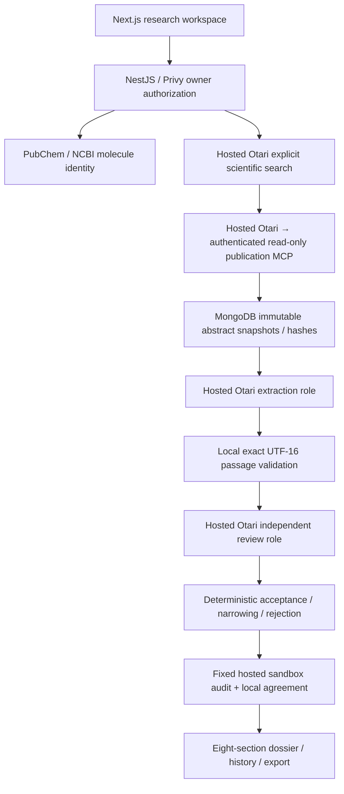

# Capela

An evidence-first molecule investigation workspace: inspect source passages, model-assisted review, deterministic corrections and uncertainty before accepting a claim.

Built for [Mozilla Developers Wilding Online](https://otari.ai/devs-wilding). The [official judging rubric](https://docs.google.com/document/d/1-spnCZ3f2SSki8cb6FnochjchdyttUsjjxfoE6aBnF4/edit) defines the competition; no awarded score or submission status is claimed.

## Current architecture



The verified isolated model pair resolved to **`openai/gpt-oss-20b` for structured extraction** and **`openai/gpt-oss-120b` for adversarial evidence review**, through hosted Otari. Configuration aliases alone do not establish model identity: run events retain observed resolved model headers. Both model repositories identify Apache 2.0 ([20b](https://huggingface.co/openai/gpt-oss-20b/blob/main/LICENSE), [120b](https://huggingface.co/openai/gpt-oss-120b/blob/main/LICENSE)). Different purposes matter; fallback alone is not a second role.

Extraction reads one stored abstract per bounded call. Review reads at most two claims per bounded call and saves completed batches. Every publishable claim must retain valid source identity/hash and exact passages, pass conservative review/classification, and pass a fixed remote audit that agrees with local validation. Model agreement is not proof of scientific truth. Animal/cell, computational and reported findings remain explicitly scoped; abstracts are never labeled full text. Evidence scores are heuristics, not efficacy probabilities.

MongoDB leases, heartbeat/fencing and durable reservations protect run ownership. Interrupted calls may have been charged and are never automatically replayed. New validated search checkpoints allow an explicit retry after MCP failure without buying the same search again; older runs without that checkpoint cannot recover invented URLs. Terminal denials stop new spending. Optional direct Vertex review is labeled **hybrid**, billed separately, and excluded from the qualifying demonstration. Original direct Gemini/Groq/Tavily implementation details live in [the archived legacy document](docs/LEGACY_ARCHITECTURE.md).

## Verification status — November 6, 2026

**The six-capability target has not been demonstrated.** Search, MCP, sandbox and the distinct open-weight role pair have historical hosted execution evidence. A historical all-Otari dossier completed with zero published claims; two newer meaningful dossiers completed through hybrid Vertex review. None establishes the requested meaningful all-Otari demonstration on the current code.

Direct authenticated MCP initialization, tool listing and canonical publication retrieval now pass, as do hosted discovery/invocation with source-hash agreement. The latest signed-in Node 24 investigation completed search, MCP retrieval, extraction and sandbox audit, but both candidates failed exact-passage checks; review was not called and the dossier contains zero claims. History/reopen and the downloaded PNG were inspected. This is a completed empty workflow, not the intended meaningful two-model demonstration. Routing recovery and finite hosted-ceiling denial remain pending dedicated test configuration. No qualifying public sample is published.

| Capability           | Code                                                                                                                                       | Actual evidence / current limit                                                         | Demonstration step                                        |
| -------------------- | ------------------------------------------------------------------------------------------------------------------------------------------ | --------------------------------------------------------------------------------------- | --------------------------------------------------------- |
| Search               | [explicit tool](apps/api/src/research/otari-search.ts)                                                                                     | November 6 hosted search used for a stored canonical abstract                           | Show search event and canonical source selection          |
| MCP                  | [retrieval](apps/api/src/research/otari-retrieval.service.ts), [authenticated server](apps/api/src/research/publication-mcp.controller.ts) | Current direct + hosted invocation and source-hash agreement                            | Show tool invocation and its stored abstract              |
| Distinct model roles | [extraction/review](apps/api/src/research/otari-evidence.service.ts)                                                                       | Historical resolved 20b/120b pair; newer successful runs hybrid                         | Show both observed models and a real review decision      |
| Sandbox              | [fixed audit](apps/api/src/research/evidence-audit.ts)                                                                                     | Current completed zero-claim audit/local agreement; nonempty hosted-only result pending | Show audit hash, accepted count and local agreement       |
| Routing recovery     | [gateway](apps/api/src/research/otari-gateway.service.ts)                                                                                  | Implemented metadata handling; controlled hosted recovery pending                       | Show actual fallback trace only after a controlled test   |
| Spending limits      | [gateway reservations/denials](apps/api/src/research/otari-gateway.service.ts)                                                             | Offline denial handling; insufficient funds is not a ceiling test                       | Show a real finite-ceiling denial with saved partial work |

At implementation commit `389e863`, Node 24 verification passed **91 unit/adapter tests, 4 integration tests and 7 browser fixtures**, plus formatting, lint, typecheck and production build. Fixed-source checks passed **10/10 source hashes, 30/30 resolvable references and 30/30 exact passages**. These checks verify stored-source integrity and passage mechanics; they do not establish scientific accuracy or show that model review improves correctness. Browser fixtures are separate from authenticated application testing.

The MCP recovery follow-up passes **92 unit/adapter tests** and the focused SDK MCP regression. The extracted-span failure and offline-only extraction-v4 correction are preserved in the recovery record; no successful two-role rerun is implied.

Exact request IDs, code-version limits and hosted versus offline status are in [capability evidence](docs/RUBRIC_EVIDENCE.md) and [test evidence](docs/TEST_EVIDENCE.md); the latest [MCP recovery record](evaluation/mcp-recovery.json) preserves actual source, candidate, tool and cost provenance.

## Run locally

Use Node 24, npm, MongoDB and the existing Privy application. Copy `.env.example` to ignored `.env.local` and configure credentials locally. Never place runtime secrets in `NEXT_PUBLIC_*` variables. Keep payments in their existing state.

```bash
nvm use
npm install
npm run dev
```

The default API is `http://localhost:4000`, web `http://localhost:3000`. Configure `NEXT_PUBLIC_API_URL` and `WEB_ORIGIN` consistently when changing ports. [Hosted setup](docs/OTARI_INTEGRATION.md) covers role policies, the authenticated remote MCP server and finite hosted ceiling. A positive application cap does not prove hosted enforcement. No paid check is authorized merely by changing an environment value; reconcile persistent task/application ledgers first. `OTARI_RUN_MAX_CALLS` optionally reduces per-run dispatches (for example five for a one-abstract verification); retries retain the original limit.

`npm run smoke:otari` reads catalogs without paid execution. Paid scripts refuse conflicting/existing task ledgers. The default application never silently switches to Gemini/Groq if Otari is unavailable. Production Privy authentication remains required for private investigations, sources, history, retries and exports.

## Verification commands

Run generated-file gates sequentially:

```bash
npm test
npm run test:integration
npm run test:browser
npm run evaluate
npm run format:check
npm run lint
npm run typecheck
npm run build
```

Unit/integration/browser fixtures spend no paid credits. `npm run evaluate` checks source hashes, reference integrity and exact passages in fixed records and writes versioned results to `evaluation/results.json`.

## API and participant handoff

Nest Swagger is at `/docs`, its OpenAPI JSON at `/docs/openapi.json`. Shared Zod contracts live in `packages/shared`; research services in `apps/api/src/research`; the responsive dossier and inspection UI in `apps/web/src`.

See the [participant recording checklist](docs/DEMO_RECORDING_CHECKLIST.md), [submission checklist](docs/SUBMISSION_CHECKLIST.md), [current rules](docs/MOZILLA_RULES.md) and [implementation plan](docs/IMPLEMENTATION_PLAN.md). The participant records actual application screens with their own audio; no generated demo video or narration is supplied. The verified submission route is the event's email thread, not an invented DoraHacks link. Nothing has been pushed, deployed, emailed or submitted by this follow-up.
